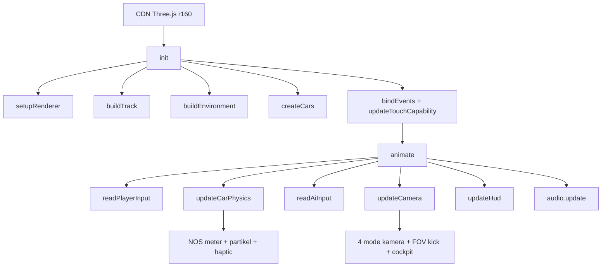

# APEX CIRCUIT 01

[](https://threejs.org/)
[](https://github.com/Ikyletwar/apex-circuit-01)
[](https://ikyletwar.github.io/apex-circuit-01/)
[](CREDITS.md)

**APEX Circuit 01** — balapan arcade 3D langsung di browser. Tiga putaran, empat pembalap, sirkuit prosedural, AI pure-pursuit, NOS yang bisa ditahan, dan kamera cockpit POV.

- **Play:** <https://ikyletwar.github.io/apex-circuit-01/>
- **Repo:** <https://github.com/Ikyletwar/apex-circuit-01>
- **Stack:** HTML + CSS + JavaScript, Three.js r160 UMD via CDN, tanpa build step.

---

## Fitur utama

| Fitur | Ringkasan |
|---|---|
| Sirkuit | `CatmullRomCurve3` tertutup, 900 sample, curb, barrier, lampu, gantry start/finish |
| Fisika | Throttle, rem, mundur, belok, grip lateral, drift, drag, penalty curb, tabrakan |
| AI | 3 lawan pure-pursuit dengan lookahead dinamis + pengereman tikungan |
| NOS | Tahan `Shift` / `F` / tombol `NOS`: +26 m/s, power ×2,15, meter 100 |
| Kamera | `CHASE`, `HOOD`, `WIDE`, `COCKPIT` / POV dengan dashboard + setir dinamis |
| Audio | Engine, countdown, impact, boost NOS — semuanya sintetis via Web Audio |
| Mobile | Auto-detect touch, tombol sentuh, haptic, layout landscape kompak |
| HUD | Speedometer, gear, lap, posisi, waktu, best lap, minimap, lap progress, toast |

---

<details>
<summary><strong>NOS — detail mekanik</strong></summary>

| Parameter | Nilai | Efek |
|---|---|---|
| Kapasitas | `100` | Penuh saat start dan setiap restart |
| Drain | `32 / detik` | Habis ≈3,1 detik jika terus ditahan |
| Recharge | `8,5 / detik` | Penuh lagi ≈11,8 detik |
| Boost top speed | `+26 m/s` | ≈216 km/h → ≈302 km/h |
| Power multiplier | `×2,15` | Akselerasi jauh lebih agresif |
| Syarat aktif | `throttle > 0` | Tidak menyala saat mobil diam atau mundur |
| Visual | FOV `+9°`, speed lines, flame biru | Dimatikan saat `prefers-reduced-motion` |
| Audio | Oscillator boost + frequency sweep | Aktif setelah user gesture pertama |
| Haptic | `navigator.vibrate(8)` | Saat NOS mulai aktif, bila didukung |

Verifikasi deterministik:

```text
0,5 detik NOS     : 100 → 84   (drain 16, sesuai 32/detik)
1 detik recharge  : 82,91 → 91,41 (+8,5)
kecepatan 0,5 dtk : NOS 30,8 m/s vs tanpa NOS 15,24 m/s
```

</details>

<details>
<summary><strong>Kamera & cockpit POV</strong></summary>

Tekan `C` atau tombol `CAM` untuk berputar:

| Mode | Posisi | Karakter |
|---|---|---|
| `CHASE` | Belakang + tinggi | Default, paling mudah membaca sirkuit |
| `HOOD` | Atas kap mesin | Agresif, garis depan dekat aspal |
| `WIDE` | Jauh di belakang | Survei seluruh tikungan |
| `COCKPIT` | Kursi pembalap | POV dalam mobil + dashboard + setir dinamis |

Di mode cockpit, `player.mesh.visible = false` agar kamera tidak terjebak di dalam geometri mobil. Setir memakai CSS variable `--wheel-angle` dan mengikuti `input.steer × 26deg`.

</details>

<details>
<summary><strong>Kontrol lengkap</strong></summary>

| Input | Aksi |
|---|---|
| `W` / `↑` | Gas |
| `S` / `↓` | Rem / mundur |
| `A` `D` / `←` `→` | Belok kiri / kanan |
| `Space` | Drift / rem tangan |
| `Shift` `F` | **NOS — tahan** |
| `C` | Ganti kamera, termasuk `COCKPIT` |
| `T` | Tampil / sembunyikan kontrol mobile — hanya di perangkat touch |
| `Esc` `P` | Jeda / lanjut |
| `M` | Bisukan suara |
| `R` | Ulang balapan |
| Tombol sentuh | `‹` `›` · `DRIFT` · `NOS` · `BRK` · `GAS` |

</details>

<details>
<summary><strong>Mobile auto-detect</strong></summary>

Kontrol sentuh tidak bergantung pada lebar viewport. Deteksi memakai:

```js
pointer: coarse
navigator.maxTouchPoints > 0
'ontouchstart' in window
```

Perilaku:

- **PC / mouse:** HUD tombol mobile dan tombol toggle `MOBILE` tidak dirender sama sekali, walaupun jendela diperkecil.
- **HP / tablet:** HUD tombol muncul otomatis saat countdown dan racing, hilang saat menu, pause, dan finish.
- **Hybrid touch laptop:** dianggap touch-capable karena `maxTouchPoints > 0`.
- **Toggle:** tombol `MOBILE / ON-OFF` dan shortcut `T` hanya tersedia di perangkat touch.
- **Haptic:** penekanan tombol, awal NOS, dan tabrakan memicu `navigator.vibrate()` bila didukung.
- **Landscape pendek:** tinggi ≤ 480 px memakai tombol lebih kompak; speedometer/minimap dipindah di atas area jari.

Verifikasi browser:

```text
390x844 PC       → capable=false, touchHidden=true,  btnHidden=true,  overflow=false
390x844 mobile   → capable=true,  touchHidden=false, 6 tombol muat,   overflow=false
844x390 landscape→ tombol 50/42/60 px, touchHidden=false, overflow=false
toggle ON → OFF  → touchHidden=true,  label=OFF, aria-pressed=false
toggle OFF → ON  → touchHidden=false, label=ON
```

</details>

<details>
<summary><strong>Arsitektur runtime</strong></summary>



</details>

<details>
<summary><strong>Jalankan & test</strong></summary>

```bash
cd apex-circuit
chmod +x run.sh
./run.sh
# http://localhost:4173
```

Alternatif:

```bash
npm start      # server statis yang sama
npm test       # regresi belok + NOS + POV + mobile
node --check app.js
```

Buka langsung `index.html` juga berjalan karena Three.js dipakai sebagai build UMD, bukan ES module lokal. Perlu internet untuk CDN Three.js + Google Fonts; font punya fallback sistem.

</details>

<details>
<summary><strong>Verifikasi</strong></summary>

| Pengujian | Hasil |
|---|---|
| `node --check app.js` | Lulus |
| `npm test` | Lulus: arah belok, NOS, POV, mobile auto-detect |
| HTTP lokal `/`, `/styles.css`, `/app.js` | `200 / 200 / 200` |
| Console browser | `0` error, `1` warning deprecation Three.js r160 UMD |
| `file://` | `window.__APEX_READY = true`, boot error tersembunyi |
| A / D | heading `+0,887` / `-0,887` rad, posisi X `+2,629` / `-2,629` simetris |
| NOS | drain `16 / 0,5 dtk`, recharge `8,5 / dtk`, boost `30,8` vs `15,24 m/s` |
| POV | `mode=3`, cockpit tampil, mesh mobil disembunyikan, setir `26deg` saat `A` |
| Mobile | PC tidak menampilkan HUD tombol; mobile menampilkan 6 tombol tanpa overflow |
| Pages | `built`, aset terbaru terserve dari `main` |

</details>

---

## Status build

```text
Repo     : Ikyletwar/apex-circuit-01
Branch   : main
Pages    : https://ikyletwar.github.io/apex-circuit-01/
PagesAPI : built · source branch=main path=/
Commit   : lihat histori commit GitHub untuk versi terbaru
```

## Catatan

- Tidak ada musik bawaan. Jika ingin musik, supply berkas sendiri ke `assets/music/` dan sertakan haknya.
- Semua geometri, tekstur, dan efek suara dibuat prosedural; tanpa aset 3D pihak ketiga.
- Lisensi dan kredit: [CREDITS.md](CREDITS.md).

---

**Catatan README:** versi ini sengaja memakai Markdown GitHub-native + `<details>` + Mermaid. Tidak ada `<style>` atau class CSS kustom, karena keduanya di-strip oleh renderer GitHub dan sebelumnya membuat CSS tampil sebagai teks mentah.
